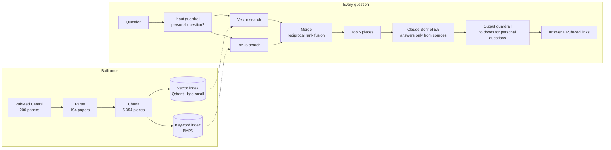

# CAR-T Literature Q&A (RAG)

A retrieval-augmented question-answering system over the published literature on **CAR-T cell therapy for
acute lymphoblastic leukemia (ALL)**. It answers questions from 194 open-access papers and cites the
source of every fact.

The project focuses on **measurement**: every change was tested on a fixed evaluation set and kept only if it helped.

> **Research and education prototype — not medical advice.** It summarizes published studies and is not
> designed or validated to guide the care of any individual patient.

---

## How it works



| Step | File | What it does |
|---|---|---|
| Collect | `src/collect.py` | Downloads open-access papers from PubMed Central (NCBI E-utilities) |
| Parse | `src/parse.py` | Converts XML to clean text by section, with title, year, author, and article type |
| Chunk | `src/chunk.py` | Recursive splitting into ~400-token pieces with sentence overlap |
| Embed | `src/embed.py` | `BAAI/bge-small-en-v1.5` vectors stored in Qdrant |
| Keyword index | `src/bm25.py` | BM25 with tokenization that keeps medical abbreviations exact ("ALL" ≠ "all", "CD22", "ZUMA-3") |
| Search | `src/retrieve.py` | Hybrid search: vector + BM25 rankings merged with reciprocal rank fusion |
| Safety | `src/guardrails.py` | Detects questions about a specific person; a code check removes doses from those answers |
| Answer | `src/generate.py` | Claude Sonnet 5.5 answers only from the 5 retrieved pieces, citing each fact |
| LangChain version | `langchain_version/` | The same system rebuilt with LangChain, for comparison |
| Evaluation | `eval/` | Exam questions, answer key, search and answer tests, LLM judge |

---

## Evaluation

- **30 questions** written to cover facts, mechanisms, comparisons, side effects, a brand-name variant,
  unanswerable and off-topic questions, and personal medical-advice questions.
- **Split:** 21 development questions (used for every decision) and 9 held-out questions (used once, at the end).
- **Answer key:** keyword rules to find candidate passages, then every passage the search surfaced was read
  and judged; reading overrides keyword matches.
- **Search metrics:** Hit@k, MRR, precision@5, recall@5.
- **Answer metrics** (graded by Claude Opus against the answer key): correctness, faithfulness, citation
  precision, abstention, medical checks (number accuracy, patient population, evidence level), and
  **context sufficiency** — whether the facts an answer needs were in the retrieved pages at all, which
  separates retrieval failures from generation failures.

### Results (development questions)

| Version | Correct | Faithful | Safe on special questions | Time per answer | Decision |
|---|---|---|---|---|---|
| Vector search only | 53% | 78% | 100% | 6.1 s | baseline |
| Hybrid search (vector + BM25) | 67% | 72% | 100% | 6.4 s | kept |
| + MedCPT reranker | 67% | 67% | 100% | 11.4 s | dropped |
| + BGE reranker | 60% | 50% | 67% | 12.7 s | dropped |
| Hybrid + safety guardrails | 67% | 67% | 100% | 6.6 s | **current** |
| LangChain version | 69%* | 76% | 100% | 6.3 s | same as current |

\*16 answerable questions after two dose questions were added; the original 15 scored the same as the current version.
"Correct" requires every key fact in the answer key.

### Held-out questions (run once)

On 7 answerable held-out questions, vector-only search scored 57% and hybrid 43% — a one-question difference,
so the development-set gain is **not confirmed**. Hybrid gave more trustworthy answers on these questions
(citation precision 100% vs 57%, faithfulness 78% vs 67%), and the safety guardrails held. A larger
evaluation set is needed.

### Findings

1. **Errors came from retrieval, not generation.** When the needed facts were on the retrieved pages, the model
   used them; it did not ignore them or add key facts from memory.
2. **The missing pages were close misses** (ranked about #12–#27), which pointed to a ranking problem.
3. **Hybrid search helped on the development set**: exact terms like drug, trial, and gene names matter, and the
   embedding model lowercases text ("ALL" the leukemia becomes "all").
4. **Rerankers did not help.** Both scored "describes the side effect" and "gives how often it happens" almost
   equally, and one surfaced a pediatric dosing page that leaked into an answer to a parent's question.
5. **Safety must not depend on retrieval.** The guardrails are code, so they hold whichever pages are found.
6. **The framework did not change the results.** The LangChain version reproduced the plain-Python results.

Full run-by-run details: [`eval/RESULTS.md`](eval/RESULTS.md). Project log and next steps: [`PROGRESS.md`](PROGRESS.md).

---

## Running it

```bash
python3 -m venv .venv && source .venv/bin/activate
pip install -r requirements.txt
echo "ANTHROPIC_API_KEY=your-key" > .env     # never commit this file

python src/collect.py      # download papers (data/ is not in the repository)
python src/parse.py
python src/chunk.py
python src/embed.py
python src/generate.py "What drugs are used to manage cytokine release syndrome after CAR-T?"
```

Evaluation:

```bash
python eval/eval_retrieval.py --mode hybrid --split dev          # search test (free)
python eval/run_answers.py --mode hybrid --label hybrid --split dev
python eval/judge.py --label hybrid --split dev                   # answer test (~$1)
```

The downloaded papers (`data/`) and the raw evaluation outputs (`eval/results/`, which contain excerpts of the
papers) are not included in this repository.

---

## Limitations

- Small corpus: 194 open-access papers; several key original trials are not open access.
- Small evaluation set: one question moves scores by 6–14 points.
- The answer key and grading were produced with AI assistance and spot-checked, not reviewed by a clinician.
- Guardrails use pattern matching and may miss unusually phrased personal questions.
- 359 tables were extracted but are not yet searched.

## Next steps

Grow the evaluation set to 50+ questions (with a fresh held-out set), fix known answer-key errors, reduce unsupported
details in answers, and try an LLM-based reranker for the remaining retrieval misses.
