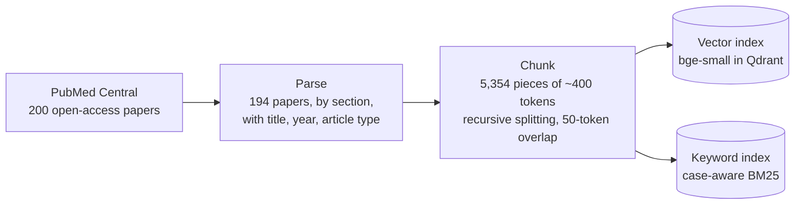
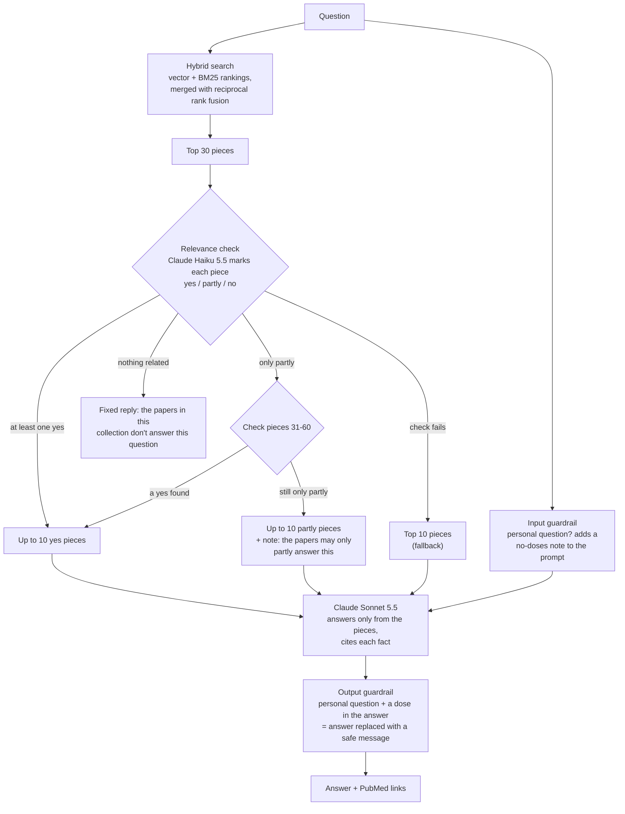
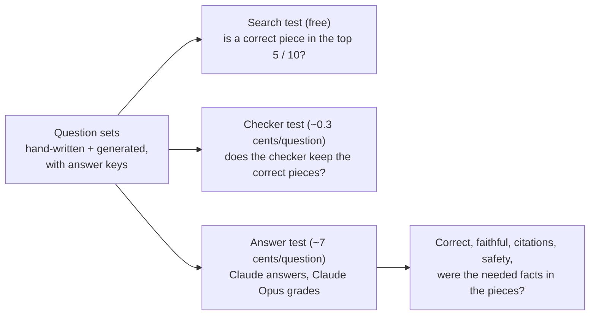

# CAR-T Literature Q&A (RAG)

A retrieval-augmented question-answering system over the published literature on **CAR-T cell therapy for
acute lymphoblastic leukemia (ALL)**. It answers questions from 194 open-access papers and cites the
source of every fact.

The project focuses on **measurement**: every change was tested on fixed question sets and kept only if it helped.
Twelve improvements were tried; four were kept: hybrid search, safety guardrails, 10 chunks instead of 5, and an
LLM relevance check before answering.

> **Research and education prototype — not medical advice.** It summarizes published studies and is not
> designed or validated to guide the care of any individual patient.

---

## How it works

**Built once (offline):**



**Every question (online):**



**How it is tested:**



| Step | File | What it does |
|---|---|---|
| Collect | `src/collect.py` | Downloads open-access papers from PubMed Central (NCBI E-utilities) |
| Parse | `src/parse.py` | Converts XML to clean text by section, with title, year, author, article type, tables and figure captions |
| Chunk | `src/chunk.py` | Recursive splitting into ~400-token pieces with sentence overlap; each piece keeps its paper and section labels (`--by-section`: section-based pieces, an experiment) |
| Embed | `src/embed.py` | `BAAI/bge-small-en-v1.5` vectors stored in Qdrant |
| Keyword index | `src/bm25.py` | BM25 with tokenization that keeps medical abbreviations exact ("ALL" ≠ "all", "CD22", "ZUMA-3") |
| Search | `src/retrieve.py` | Hybrid search: vector + BM25 rankings merged with reciprocal rank fusion |
| Relevance check | `src/relevance_check.py` | Claude Haiku 5.5 marks the top 30 pieces yes / partly / no; only "yes" pieces (up to 10) go to the answer |
| Safety | `src/guardrails.py` | Input: detects questions about a specific person and tells Claude not to give doses. Output: if a dose appears in such an answer anyway, code replaces the answer with a safe message |
| Answer | `src/generate.py` | Puts it together: search, relevance check, guardrails, and Claude Sonnet 5.5 answering only from the kept pieces, citing each fact |
| Index versions | `src/index_config.py` | Switch between index versions with `RAG_INDEX`: text (default), text + tables/figures, fine-tuned model, section-based, parent-child (experiments) |
| Parent-child chunks | `src/chunk_children.py` | Cuts each piece into 1–3-sentence children for the parent-child experiment |
| LangChain version | `langchain_version/` | The same system rebuilt with LangChain, for comparison |
| Fine-tuning | `train/` | Contrastive fine-tuning of the embedding model (experiment) |
| Evaluation | `eval/` | Question sets, answer keys, search and answer tests, LLM judge |

---

## Evaluation

**Question sets** (each with an answer key: the correct answer, facts it must include, mistakes to avoid,
and which passages contain the answer):

| Set | Questions | Written by | Used for |
|---|---|---|---|
| Practice | 30 | hand-written | building the system (hybrid search, guardrails) |
| Final | 25 | hand-written from reading the papers | a sealed test, incl. safety questions |
| Holdout | 16 | hand-written | comparing later versions |
| Generated | 30 + 50 + 40 | Claude, from single passages (and passage pairs) | comparing versions on fresh questions |

- Every set covers facts, mechanisms, comparisons and side effects; the hand-written sets also include
  unanswerable, off-topic and personal medical-advice questions.
- **Search test (free, local):** Hit@k, MRR, precision@5, recall@5.
- **Answer test:** Claude Opus grades each answer against the answer key for correctness, faithfulness, citation
  precision, abstention, medical checks (numbers, patient population, evidence level), harm, and
  **context sufficiency** — whether the needed facts were in the retrieved pages at all, which separates
  retrieval failures from generation failures.
- Evaluation scripts save after every answer and grade, and resume after an interruption.

### Results

| Version (practice questions) | Correct | Faithful | Safe on special questions | Time per answer | Decision |
|---|---|---|---|---|---|
| Vector search only | 53% | 78% | 100% | 6.1 s | baseline |
| Hybrid search (vector + BM25) | 67% | 72% | 100% | 6.4 s | kept |
| + MedCPT reranker | 67% | 67% | 100% | 11.4 s | dropped |
| + BGE reranker | 60% | 50% | 67% | 12.7 s | dropped |
| Hybrid + safety guardrails | 67% | 67% | 100% | 6.6 s | **current** |
| LangChain version | 69%* | 76% | 100% | 6.3 s | same as current |

\*16 answerable questions after two dose questions were added. "Correct" requires every key fact in the answer key.

**Sealed final set (25 new hand-written questions), current version:** 48% correct, 100% safe on the special
questions, 0 serious errors. The drop from the practice set is expected: the system was tuned on the practice
questions, so 48% is the more honest estimate for unseen questions.

### Findings

1. **Errors come from retrieval, not generation.** Across every test, about 94% of the key facts missing from
   answers were never on the retrieved pages; when the facts were there, Claude used them.
2. **Most misses are close or partial**: the right page ranks just below the top 5, or a two-part question gets
   pages for only one part.
3. **Hybrid search helped**: exact terms like drug, trial and gene names matter, and the embedding model lowercases
   text ("ALL" the leukemia becomes "all").
4. **Rerankers did not help.** Both scored "describes the side effect" and "gives how often it happens" almost
   equally, and one surfaced a pediatric dosing page that leaked into an answer to a parent's question.
5. **Safety must not depend on retrieval.** The guardrails are code, so they hold whichever pages are found.
6. **The framework did not change the results.** The LangChain version reproduced the plain-Python results.
7. **Scores split by question type and by how questions were written** (`eval/slice_report.py`): on questions with
   every answer page marked, the search finds number answers (83%) but ranks them lower than mechanism answers.
   Script-generated questions mark only one answer page, so their low scores partly reflect the answer key.

### Change after the final results: 10 pages instead of 5

The results above used 5 pages. A free check read pages #6–10 for each key fact the judge found missing: 13 of 34
were there, which could fix up to 7 of 60 answers (37 → 44 correct) if Claude uses them. Claude now gets 10 pages.

**Answer test, final set (25 questions), 5 → 10 pages:**

| | 5 pages | 10 pages |
|---|---|---|
| Correct (answerable) | 10 of 21 (48%) | **14 of 21 (67%)** |
| Faithful | 13 of 21 | 11 of 21 |
| Key facts missing from the pages | 13 | 8 |
| Safe on special questions | 4 of 4 | 4 of 4 |
| Serious errors | 0 | 0 |
| Cost per answer / median time | $0.015 / 6.9 s | $0.023 / 7.6 s |

- The 4 newly correct answers are exactly the 4 the free check predicted (q37, q43, q44, q50); none got worse.
- The new unfaithful answers are all minor attribution slips (a journal name, "adults" for an unlabeled cohort,
  mixing two sources), the same habit as before; more pages give more chances to mix sources.
- The final set was used to choose 10 pages, so this confirms the prediction rather than giving a fresh estimate.
Details: [`eval/RESULTS.md`](eval/RESULTS.md).

### Relevance check before answering (current version)

The search ranks pieces by how much they are *about* the question's topic; it cannot tell which piece *contains the
answer* (e.g. "How common is ICANS?" ranks pieces describing ICANS above the piece giving its rate, #13). Three
chunking changes (section-based chunks, contextual headers, parent-child chunks) did not fix this, because every
version still compares the question and each piece separately.

The relevance check reads the question together with the top 30 pieces (Claude Haiku 5.5, ~0.3 cents per question)
and marks each one yes / partly / no:

| Checker result | What happens |
|---|---|
| at least one "yes" | Claude answers from the "yes" pieces (up to 10) |
| only "partly" | pieces #31–60 are checked too; if still no "yes", Claude answers from the "partly" pieces and says the papers only partly address the question |
| nothing related | a fixed reply, "The papers in this collection don't answer this question" (no answer is written) |
| the check fails | Claude answers from the top 10 pieces, as before |

This is a simplified, Corrective-RAG-style check: no web search (answers come only from the curated papers) and no
sentence-level refinement inside pieces.

**Checker alone** (151 questions, $0.42): the pieces Claude reads that contain the answer went from 47% to 70% on
hand-written questions (10 → 8 pieces), and the answer piece was found for 12 more generated questions (55 → 67 of 80).
No answerable question was blocked.

**Answer test, final set (25 questions):**

| | Top 10 pieces | With the relevance check |
|---|---|---|
| Correct (answerable) | 14 of 21 (67%) | **17 of 21 (81%)** |
| Key facts missing from the pieces | 8 | **4** |
| Safe on special questions | 4 of 4 | 4 of 4 |
| Serious errors | 0 | 0 |
| Citations check out | 18 of 21 | 15 of 21 |
| Cost per question | ~2.3 cents | ~2.3 cents (answer ~2.0 + check ~0.3) |

- 5 answers became correct (q33, q36, q41, q45, q47) and 2 became wrong (q31, q40); the new citation slips are minor
  (study type or population labels).
- The checker's instructions were written before any answers were seen and were not changed afterwards.
- **Known weaknesses:** the checker treats mechanism evidence from other cancers as only "partly" relevant (q40 lost a
  key point), and on two-part questions it can keep the part with a number and drop the definition (q31). Fixing them
  needs a test on fresh questions, to avoid tuning the checker to this test set.

Details: [`eval/RESULTS.md`](eval/RESULTS.md).

---

## Experiments that were tried and not adopted

Each was tested against the current version on the same questions. Full numbers: [`eval/RESULTS.md`](eval/RESULTS.md).

**Tables and figure captions as extra chunks** (`src/chunk_extras.py`; 1,299 table + 791 figure chunks)
- Same correctness (75% vs 75% holdout, 70% vs 70% generated); fewer unsupported details (faithful 62% → 81% and
  73% → 87%), confirmed with a repeat run of the baseline. Occasionally a table chunk pushed out the right text page.
- Kept as an option (`RAG_INDEX=plus`), not the default.

**Contrastive fine-tuning of the embedding model** (`train/`)
- bge-small fine-tuned with MultipleNegativesRankingLoss (in-batch + hard negatives mined with hybrid search) on 432
  Claude-written questions from pages no test uses; trained on a free Colab GPU.
- Search: right page in the top 5 for 68% → 75% of 142 questions. Answers: 59% → 66% correct over 140 questions,
  same safety.
- **But the whole gain was on Claude-generated questions (46 → 56 of 80); on hand-written ones it was 37 → 37 of 60.**
  The model learned the style of its training questions more than the content. Excluding every test page from
  training (to avoid leakage) also meant it never trained on the core topics.

**Multi-query decomposition** (`eval/decompose_questions.py`, `eval/eval_multiquery.py`)
- Claude splits a question into 2–3 searches; all result lists are merged with reciprocal rank fusion.
- Two-part questions, both answer pages in the top 5: 25% → 25%. One-part questions: 75% → 65% (worse).
- Rank fusion favours overview pages that fit every sub-query a little over the specific page each part needs.

**Section-based chunking and contextual headers** (`python src/chunk.py --by-section`, `RAG_INDEX=section`,
`RAG_INDEX=section_hdr`; answer key translated to the new pieces by `eval/section_labels.py`)
- Section-based alone: no change (only 16% of the original pieces crossed a section; pieces inside one section still
  mix topics). With a "Paper / Section" header: +6 points top-5 overall, but no gain on hand-written questions
  (top 10: 94% → 90%); the paper title boosts every piece of a paper whose title shares the question's words.

**Parent-child chunking** (`src/chunk_children.py`, `RAG_INDEX=child`, `child_sec`, `child_hdr`)
- The search reads 1–3-sentence children and returns their parent pieces. Best version (with a full header): MRR 0.66
  → 0.69 and top 5 84% → 87% on hand-written questions, but top 10 unchanged (94%). The ICANS-rate piece fell from #13
  to #45: single sentences that only describe ICANS now compete directly with the one giving its rate.

---

## Running it

```bash
python3 -m venv .venv && source .venv/bin/activate
pip install -r requirements.txt
echo "ANTHROPIC_API_KEY=your-key" > .env     # never commit this file

python src/collect.py      # download papers (data/ is not in the repository)
python src/parse.py
python src/chunk.py
python src/embed.py
python src/generate.py "What drugs are used to manage cytokine release syndrome after CAR-T?"
```

Evaluation (`--split`: practice, final, holdout, synthetic, confirm, mq):

```bash
python eval/eval_retrieval.py --mode hybrid --split final         # search test (free)
python eval/run_answers.py --mode live --split final --label live  # current system: search + relevance check
python eval/judge.py --split final --label live                   # answer test (~$1.80 per 25 questions, both steps)
```

`--mode hybrid` answers from the top 10 pieces without the relevance check (every run before it). To test the
relevance check without paying for it twice: `python eval/check_chunks.py` (saves the checker's verdicts,
~0.3 cents per question), `python eval/checker_report.py` (free comparison), then `--mode checked`.

Other index versions: `RAG_INDEX=plus python src/embed.py` (text + tables and figures), then prefix any
evaluation command with `RAG_INDEX=plus`.

The downloaded papers (`data/`), raw evaluation outputs (`eval/results/`, which contain excerpts of the papers),
and the fine-tuned model are not included in this repository.

---

## Limitations

- Small corpus: 194 open-access papers; several key original trials are not open access.
- Small hand-written evaluation sets: one question moves a score by 4–7 points.
- Generated question sets list only the passage each question came from, so other valid pages count as misses.
- The answer keys and grading were produced with AI assistance and spot-checked, not reviewed by a clinician.
- Guardrails use pattern matching and may miss unusually phrased personal questions (one such case on the final set
  was still answered safely).
- The relevance check was tested on the 25-question final set, which had already been used to choose 10 pieces; it
  has known weaknesses on mechanism and two-part questions (see above), and adds one model call per question.

## Possible next steps

- A fresh test set (answer keys for the 34 unused holdout questions, q72–q105) to confirm the 10-piece switch and the
  relevance check, and to test fixes for the checker's two weaknesses without tuning on the same questions.
- A prompt rule against adding details the source does not state (journal names, patient ages, study type).
- Fine-tuning again on all pages with question-style training data, and HyDE (searching with a hypothetical answer).
- A small production demo: API, container, and a rate-limited public link.
